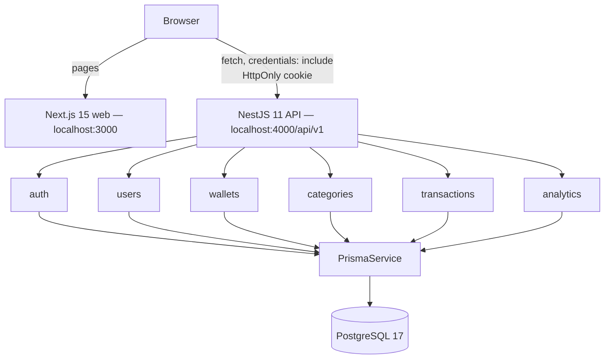

# Spendly — Architecture

A modular monolith: one Next.js app, one NestJS API, one PostgreSQL database, one
Prisma schema. No queues, caches or microservices.



## API (`apps/api`)

```
src/
  main.ts / app.setup.ts     bootstrap; app.setup is shared with the e2e tests
  app.module.ts              global JwtAuthGuard + ThrottlerGuard, Origin-check middleware
  auth/                      register / login / logout / me, JWT strategy, default seed data
  users/                     GET/PATCH /users/me
  wallets/                   CRUD + archive; balances come from AnalyticsService
  categories/                CRUD + archive; type is immutable
  transactions/              CRUD, filters, pagination, ownership + type checks
  analytics/                 all aggregate SQL ($queryRaw, parameterized)
  common/                    exception filter, validators, decorators, money/date utils
prisma/
  schema.prisma, migrations/, seed-demo.ts
test/                        Jest + Supertest e2e suites against spendly_test
```

**Request lifecycle (POST /transactions):**

1. `OriginCheckMiddleware` rejects non-GET requests from foreign origins (CSRF).
2. `ThrottlerGuard`, then the global `JwtAuthGuard`. Every route is private unless marked
   `@Public()`. The JWT comes from the `spendly_session` HttpOnly cookie (or a
   Bearer header for API clients), and the user must still exist.
3. `ValidationPipe` (`whitelist` + `forbidNonWhitelisted`) validates the DTO. Unknown
   fields such as `userId` are rejected with a 400.
4. Controllers stay thin. They pass `@CurrentUser().id` (from the token, never from the
   request) to the service.
5. The service checks that the wallet and category belong to the user, are active, and that the types match.
6. Prisma inserts. The composite FKs re-check ownership and type in the database.
7. `AllExceptionsFilter` maps errors to `{ statusCode, error, message, errors? }`.
   Prisma's P2002, P2003 and P2025 become 409/409/404. Anything else becomes a generic 500,
   logged server-side only.

**Ownership:** every query is scoped with `user_id = <token sub>`. Another user's
record returns the same 404 / "not found" as a nonexistent one, so UUIDs can't be
probed.

## Web (`apps/web`)

```
src/
  app/(auth)/login, register        public pages
  app/(app)/dashboard, transactions, transactions/new, transactions/[id]/edit,
            wallets, categories, settings
  middleware.ts                     UX redirect to /login when no session cookie
  features/auth|dashboard|transactions/   feature components
  components/ui/                    Button, Input/Select, Field, Card, Dialog, …
  lib/api.ts                        fetch wrapper (credentials: include, ApiError)
  lib/queries.ts                    TanStack Query hooks + invalidation rules
```

* **Server state** lives in TanStack Query. Any mutation that touches money invalidates
  `transactions`, `analytics`, `wallets` and `categories`, so every number shown is
  re-fetched from the API. The client never adds up totals itself.
* **Forms** use react-hook-form + zod for instant inline errors. The API's field errors
  (`errors[]`) are mapped back onto the same fields.
* **Accessibility:** labelled inputs (`Field` wires `id`, `aria-describedby`,
  `aria-invalid`), native `<dialog>` for modals (focus trap + Escape), a
  radio-group segmented control, a skip link, `aria-current` nav, and table captions/scopes.

## Auth & security decisions

| Decision | Why |
|---|---|
| JWT in an **HttpOnly, SameSite=Lax** cookie (`Secure` in production) | Not readable by JS, so XSS cannot steal it. Lax blocks cross-site POSTs carrying it. |
| `Origin` check on state-changing requests | Second CSRF layer. Browsers always send `Origin` on cross-origin writes. |
| Argon2id (19 MiB, t=2, p=1) | OWASP-recommended parameters. |
| Constant-ish login timing (dummy hash verify) + one generic error | Prevents account enumeration. |
| Rate limit 10/min on `/auth/register` and `/auth/login` | Basic brute-force protection (disabled under `NODE_ENV=test`). |
| `helmet()` headers, CORS restricted to `FRONTEND_URL` with credentials | Standard hardening. |
| `JWT_ACCESS_EXPIRES_IN=1d`, no refresh token | MVP simplicity. The cookie `maxAge` uses the same parser, so they expire together. Logout clears the cookie, but a stolen token stays valid until it expires (no server-side revocation list). |

This is a learning MVP: the implementation follows good practice, but it has **not** been
security-reviewed for production.

## Local vs. deployed

* Local: Postgres 17 in Docker (`docker-compose.yml`, host port 5434), with `spendly_dev`
  and `spendly_test` databases.
* Neon: put the **pooled** URL in `DATABASE_URL` and the **direct** URL in `DIRECT_URL`
  (Prisma uses `directUrl` for migrations, which need a session, not PgBouncer).
* Deployed web and API on different sites (e.g. `*.vercel.app` + `*.onrender.com`) would
  make the cookie third-party. Serve both under one registrable domain (e.g.
  `app.example.com` + `api.example.com`) so `SameSite=Lax` keeps working.
