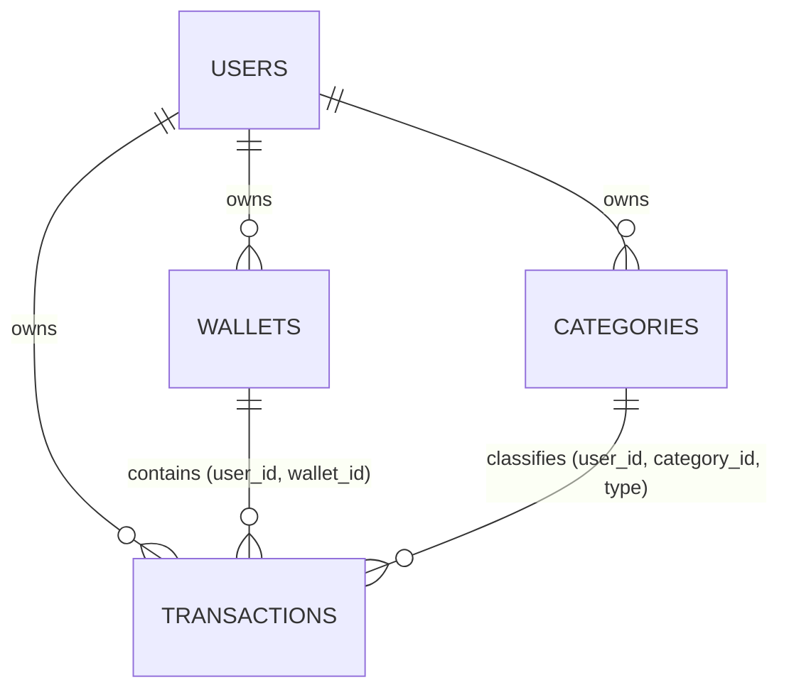

# Spendly — Database design

PostgreSQL 17 (local Docker) / Neon in the cloud, managed with Prisma 6.
Schema: [`apps/api/prisma/schema.prisma`](../apps/api/prisma/schema.prisma).
Migration: [`apps/api/prisma/migrations/20261117000000_init/migration.sql`](../apps/api/prisma/migrations/20261117000000_init/migration.sql).

## 1. Entities and relationships



| Table          | Purpose                                              | Notes |
| -------------- | ---------------------------------------------------- | ----- |
| `users`        | Account + Argon2id password hash                     | email stored normalized (trim + lower-case) |
| `wallets`      | Where money lives (Main Wallet, Cash, Savings…)      | **no balance column**; `currency` fixed to `PKR` |
| `categories`   | Per-user income/expense labels                       | `type` is `INCOME` or `EXPENSE`; archivable |
| `transactions` | One money movement                                   | `amount NUMERIC(12,2) > 0`, `transaction_date DATE` |

The schema is in 3NF: every non-key column depends only on its row's key. The one
deliberate duplication is `transactions.user_id` and `transactions.type`. Both can
technically be derived from the wallet and category. They are kept on purpose because:

* `user_id` lets every query start with `WHERE user_id = $1` against a composite index,
  without a join, and it participates in the ownership foreign keys below.
* `type` lets analytics filter income and expenses without joining `categories`. The
  composite FK below guarantees it can never disagree with the category's type.

## 2. Integrity rules and where they are enforced

Every rule is checked in the NestJS service (for friendly error messages). Wherever
possible it is **also** enforced by the database, so a bug in application code
cannot corrupt data. `test/database-constraints.e2e-spec.ts` proves each DB rule
by writing raw SQL that bypasses the API.

| # | Rule | API | Database |
|---|------|-----|----------|
| 1 | Email unique | ✔ 409 | `users_email_key` UNIQUE + `users_email_normalized_chk` CHECK (`email = lower(btrim(email))`) — together, case-insensitive uniqueness |
| 2 | Wallet names unique per user, case-insensitive | ✔ 409 | `wallets_user_id_lower_name_key` UNIQUE on `(user_id, lower(name))` |
| 3 | Category names unique per user **and type**, case-insensitive | ✔ 409 | `categories_user_id_type_lower_name_key` UNIQUE on `(user_id, type, lower(name))` |
| 4 | Amount > 0 | ✔ 400 | `transactions_amount_positive_chk` |
| 5 | Transaction's wallet belongs to the same user | ✔ 400 | **composite FK** `(user_id, wallet_id) → wallets(user_id, id)` |
| 6 | Transaction's category belongs to the same user | ✔ 400 | **composite FK** `(user_id, category_id, type) → categories(user_id, id, type)` |
| 7 | Transaction type = category type | ✔ 400 | same composite FK (includes `type`) |
| 8 | Archived wallet/category not selectable for new transactions | ✔ 400 | app only (it's a workflow rule, not an invariant: old rows stay valid) |
| 9 | Existing transactions stay valid after archiving | ✔ | archiving is a flag; FKs are untouched |
| 10 | No hard delete of a wallet/category with transactions | ✔ 409 | FKs are `ON DELETE NO ACTION` |
| – | PKR only | – | `wallets_currency_pkr_chk` |
| – | Names not blank | ✔ 400 | `*_name_not_blank_chk` |

### The composite-FK trick (rules 5–7)

`wallets` has `UNIQUE (user_id, id)` and `categories` has `UNIQUE (user_id, id, type)`.
`id` alone is already unique, so these add no restriction on their own. They exist only so
that `transactions` can reference them with **multi-column** foreign keys:

```sql
FOREIGN KEY (user_id, wallet_id)            REFERENCES wallets    (user_id, id)
FOREIGN KEY (user_id, category_id, type)    REFERENCES categories (user_id, id, type)
```

A row can therefore only point to a wallet or category whose `user_id` equals its own
`user_id`, and to a category whose `type` equals its own `type`. Even if someone
learned another user's wallet UUID and a service forgot the ownership check, the insert
would fail with `transactions_wallet_owner_fkey`.

Prisma can express these relations natively (`fields: [userId, walletId], references: [userId, id]`).
Things Prisma cannot express were added as **hand-written SQL appended to the
generated migration**: CHECK constraints and expression indexes on `lower(name)`.
After editing, `prisma migrate diff --from-migrations … --to-schema-datamodel …`
reports an empty diff, so future `prisma migrate dev` runs will not try to drop them.

### Delete behaviour

* `users → *` is `ON DELETE CASCADE`: deleting an account removes all of its data.
* `transactions → wallets/categories` is `ON DELETE NO ACTION`. It blocks hard-deleting
  a wallet or category that is in use, but because `NO ACTION` is checked at the *end*
  of the statement, it still lets a user deletion cascade through every table in one go.
  (`RESTRICT` would fire immediately and break the cascade.)

## 3. Money and dates

* `amount NUMERIC(12,2)`, Prisma `Decimal`, and serialized to JSON as a **string**
  (`"1234.50"`). Floats never touch money on the server. The browser converts to a
  number only to display it.
* The sign lives in `type`, never in `amount`.
* `transaction_date DATE` is a calendar date, not a timestamp. The API accepts
  strict `YYYY-MM-DD` (rejecting impossible dates like `2026-02-30`). The frontend computes
  "today" and month boundaries in the user's local timezone.

## 4. Balances are derived, never stored

```
wallet balance = SUM(income amounts) − SUM(expense amounts)   -- all-time, per wallet
period net     = total income − total expenses                 -- within a date range
```

There is no `balance` column, so editing or deleting a transaction can never cause
drift. The dashboard labels the two numbers differently ("Period net" vs. "Wallet
balance, all-time").

## 5. Registration is atomic

`AuthService.register` creates the user, the **Main Wallet**, and the 11 default
categories inside one `prisma.$transaction`. If any statement fails (e.g. the email is
taken), PostgreSQL rolls the whole thing back and no half-initialised account remains.

## 6. Indexes — and the query each one serves

| Index | Serves |
|-------|--------|
| `users_email_key (email)` UNIQUE | Login lookup by email; uniqueness |
| `wallets_user_id_id_key (user_id, id)` UNIQUE | Target of the ownership FK |
| `wallets_user_id_lower_name_key (user_id, lower(name))` UNIQUE | Case-insensitive name uniqueness |
| `wallets_user_id_is_archived_idx (user_id, is_archived)` | "My active wallets" |
| `categories_user_id_id_type_key (user_id, id, type)` UNIQUE | Target of the ownership+type FK |
| `categories_user_id_type_lower_name_key (user_id, type, lower(name))` UNIQUE | Name uniqueness; also serves "categories of user X" scans |
| `categories_user_id_type_is_archived_idx (user_id, type, is_archived)` | "Active EXPENSE categories" for the transaction form |
| `transactions_user_id_transaction_date_idx (user_id, transaction_date)` | Default list (newest first), period summary, monthly trend |
| `transactions_user_id_type_transaction_date_idx (user_id, type, transaction_date)` | Category breakdown (type + range), type filter on the list |
| `transactions_user_id_wallet_id_transaction_date_idx (user_id, wallet_id, transaction_date)` | Wallet filter, per-wallet balance, the wallet FK check |
| `transactions_user_id_category_id_transaction_date_idx (user_id, category_id, transaction_date)` | Category filter, "is this category used?", the category FK check |

The last two also index the referencing side of the composite FKs. PostgreSQL does
not create those automatically, and without them every wallet/category delete would
scan `transactions`.

**Honest note on redundancy:** at a few wallets/categories per user, the two
`*_is_archived_idx` indexes add little over the unique indexes that already lead with
`user_id` (EXPLAIN Q3/Q4 below shows the planner using the `lower(name)` index for plain
`user_id` lookups). They are kept because the brief lists them and they are cheap at
this table size. They are the first candidates to drop if write cost ever matters.

## 7. EXPLAIN ANALYZE (60k transactions across 301 users)

Generated with `pnpm db:seed:demo -- --bench`, then `ANALYZE`. Times are from a laptop.

**Q1 — default transaction list (page 1, newest first)**

```
Limit (actual time=0.098..0.101 rows=20)
  -> Incremental Sort  Sort Key: transaction_date DESC, created_at DESC, id DESC
                       Presorted Key: transaction_date
     -> Index Scan Backward using transactions_user_id_transaction_date_idx
          Index Cond: (user_id = '…')            rows=21  Buffers: shared hit=4
Execution Time: 0.135 ms
```
The index already returns rows in date order, so Postgres reads only about 21 index entries
and does a tiny incremental sort for the tie-breakers. No full sort, no table scan.

**Q2 — period summary (income / expense for November)**

```
Aggregate
  -> Bitmap Heap Scan on transactions   rows=15
     -> Bitmap Index Scan on transactions_user_id_transaction_date_idx
          Index Cond: user_id = '…' AND transaction_date >= '2026-11-01' AND <= '2026-11-30'
Execution Time: 0.034 ms
```

**Q3 — category breakdown (expenses in a month)**

```
Sort -> GroupAggregate -> Hash Join
  -> Bitmap Index Scan on transactions_user_id_type_transaction_date_idx
       Index Cond: user_id = '…' AND type = 'EXPENSE' AND transaction_date BETWEEN …
  -> Bitmap Index Scan on categories_user_id_type_lower_name_key (user_id = '…')
Execution Time: 0.158 ms
```
All three index columns are used as bounds, so only the 14 matching rows are touched.

**Q4 — wallet filter**

```
Index Only Scan using transactions_user_id_wallet_id_transaction_date_idx
  Index Cond: user_id = '…' AND wallet_id = … AND transaction_date >= '2026-06-01'
Execution Time: 0.083 ms
```

Without `user_id`-leading indexes, each of these would be a sequential scan over
all 60k rows of every tenant.

## 8. SQL exercises

All use bind parameters (`$1`, `$2`, …). In the code, Prisma's tagged-template
`$queryRaw\`…${value}…\`` produces exactly these parameterized statements. Nothing is
string-concatenated. The live versions are in
[`analytics.service.ts`](../apps/api/src/analytics/analytics.service.ts).

**1. All transactions for a user, newest first (stable pagination)**
```sql
SELECT t.id, t.amount, t.type, t.description, t.transaction_date,
       w.name AS wallet, c.name AS category
FROM transactions t
JOIN wallets    w ON w.user_id = t.user_id AND w.id = t.wallet_id
JOIN categories c ON c.user_id = t.user_id AND c.id = t.category_id
WHERE t.user_id = $1
ORDER BY t.transaction_date DESC, t.created_at DESC, t.id DESC
LIMIT $2 OFFSET $3;
```

**2. Total income and expenses for a date range**
```sql
SELECT COALESCE(SUM(amount) FILTER (WHERE type = 'INCOME'),  0) AS income,
       COALESCE(SUM(amount) FILTER (WHERE type = 'EXPENSE'), 0) AS expense
FROM transactions
WHERE user_id = $1 AND transaction_date BETWEEN $2 AND $3;
```

**3. Expenses grouped by category (with share of total)**
```sql
SELECT c.id, c.name, SUM(t.amount) AS total, COUNT(*) AS count,
       ROUND(100 * SUM(t.amount) / SUM(SUM(t.amount)) OVER (), 2) AS percentage
FROM transactions t
JOIN categories c ON c.id = t.category_id AND c.user_id = t.user_id
WHERE t.user_id = $1 AND t.type = 'EXPENSE'
  AND t.transaction_date BETWEEN $2 AND $3
GROUP BY c.id, c.name
ORDER BY total DESC;
```
`SUM(SUM(x)) OVER ()` is a window over the grouped rows: the grand total, computed in
the same pass.

**4. Monthly income and expenses, last six months (empty months included)**
```sql
WITH months AS (
  SELECT generate_series($2::date - interval '5 months', $2::date, interval '1 month')::date AS month_start
),
totals AS (
  SELECT date_trunc('month', transaction_date)::date AS month_start,
         SUM(amount) FILTER (WHERE type = 'INCOME')  AS income,
         SUM(amount) FILTER (WHERE type = 'EXPENSE') AS expense
  FROM transactions
  WHERE user_id = $1
    AND transaction_date >= (SELECT MIN(month_start) FROM months)
    AND transaction_date <  $2::date + interval '1 month'
  GROUP BY 1
)
SELECT to_char(m.month_start, 'YYYY-MM') AS month,
       COALESCE(t.income, 0) AS income, COALESCE(t.expense, 0) AS expense
FROM months m LEFT JOIN totals t USING (month_start)
ORDER BY m.month_start;
```
(`$2` = first day of the last month in the window.) The `totals` CTE does **one** index
range scan for the whole window. The `LEFT JOIN` onto the generated series makes sure
months with no activity still appear as zeros.

**5. Each wallet's calculated balance**
```sql
SELECT w.id, w.name,
       COALESCE(SUM(CASE WHEN t.type = 'INCOME' THEN t.amount ELSE -t.amount END), 0) AS balance
FROM wallets w
LEFT JOIN transactions t ON t.user_id = w.user_id AND t.wallet_id = w.id
WHERE w.user_id = $1
GROUP BY w.id
ORDER BY w.is_archived, w.created_at;
```
`LEFT JOIN` keeps wallets with no transactions (balance 0).

**6. Top five expense categories for a period**: query 3 plus `LIMIT 5`
(`GET /analytics/category-breakdown?limit=5`).

### Prisma vs. raw SQL

* **CRUD and the transaction list** use the Prisma query API (`findMany` with `where`,
  `orderBy`, `skip`, `take`, `include`). With `DEBUG=prisma:query` you can see it emit
  a `SELECT … WHERE user_id = $1 … ORDER BY … LIMIT $n OFFSET $m` plus **separate**
  `SELECT … WHERE id IN (…)` queries for `wallet` and `category`, instead of a `JOIN`.
  That's fine for a page of 20 rows.
* **Analytics** use `$queryRaw`. Prisma's `groupBy` can't express `FILTER (WHERE …)`,
  window functions, `generate_series` or `date_trunc` bucketing. It would also force
  either several round trips or summing in JavaScript, which the brief forbids for
  authoritative totals.
